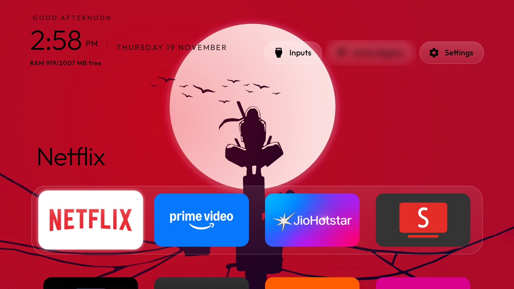

# Itachi-Style TV



> ### ⭐ Credit where it's due
> This project is a customization of **[Gathin's tv-vibehack](https://github.com/Gathin23/tv-vibehack)** (MIT).
> The original launcher package is `com.gathin.tvhome`, authored by [Gathin](https://github.com/Gathin23).
> All credit for the launcher and the debloat tooling goes to the original author.
> **Please star the original repo:** https://github.com/Gathin23/tv-vibehack

A clean, Apple TV–style home screen for Android TV.

Customized with:

- **Black header text** (clock, greeting, date, app-name title) and **black pills** (Inputs, Wi-Fi, Settings) for light wallpapers.
- **RAM label** under the clock (`RAM 896/2007 MB free`).
- **4 dock apps**: Netflix, Prime Video, Hotstar, SmartTube.
- **Itachi moon wallpaper** (bundled in `wallpapers/`).
- Wi-Fi name shows correctly (location enabled).
- Wake-from-standby fix (screensaver on sleep disabled).

Tested on **Xiaomi Mi TV MiTV-AXSO2 (Android 9)**.

## Contents

- `launcher/` — Android launcher source (Java, Android 8+).
- `dist/itachi-tv-home.apk` — prebuilt APK (install without building).
- `wallpapers/itachi-moon.jpg` — the bundled wallpaper.
- `tools/` — helper scripts (debloat, theme, restore).
- `examples/` — device-specific debloat lists.

## Prerequisites

- TV and PC on the **same Wi-Fi**.
- On the TV: Settings → Device Preferences → About → press OK on **Build** 7 times → Developer options → enable **USB debugging** (and **Network/ADB debugging** if shown).
- **Enable Location** on the TV (required for the Wi-Fi name to show): Settings → Device Preferences → Location → On. Or via ADB: `adb shell settings put secure location_providers_allowed +gps`.
- On the PC: `adb`, and (only if building) JDK 17 + Android SDK (build-tools 34, platform android-34).

## 1. Connect

```bash
adb connect <TV_IP>:5555
adb devices -l
```

Accept "Allow USB debugging?" on the TV.

## 2. Debloat (disable, not uninstall)

```bash
# Pick a list matching your TV from examples/ (e.g. examples/xiaomi-mitv-axso0/debloat.txt)
TV_HOST=<TV_IP> tools/disable.sh examples/xiaomi-mitv-axso0/debloat.txt
```

Nothing is uninstalled; `tools/restore.sh` undoes it.

## 3. Install the launcher

### Option A — prebuilt APK (fastest)

```bash
adb connect <TV_IP>:5555
adb install -r dist/itachi-tv-home.apk
adb shell cmd package set-home-activity --user 0 com.gathin.tvhome/.MainActivity
# Disable the stock launcher so Home goes to this one:
adb shell pm disable-user --user 0 com.google.android.tvlauncher
```

### Option B — build from source

```bash
cd launcher
export JAVA_HOME=/path/to/jdk17
export ANDROID_HOME=/path/to/android/sdk
./build-and-install.sh   # set TV_HOST=<TV_IP> if you want it to install too
```

## 4. Set the wallpaper

```bash
DIR=/sdcard/Android/data/com.gathin.tvhome/files
adb shell mkdir -p $DIR
adb push wallpapers/itachi-moon.jpg $DIR/wallpaper.jpg
adb shell "am force-stop com.gathin.tvhome; am start -n com.gathin.tvhome/.MainActivity"
```

The launcher reads `wallpaper.jpg` on start (single image, no rotation).

## 5. Wake-from-standby fix

Mi TVs can fail to wake from deep sleep. Disable the screensaver-on-sleep:

```bash
adb shell settings put secure screensaver_activate_on_sleep 0
```

If it still won't wake, keep the device awake while plugged in (stronger, keeps screen on):

```bash
adb shell settings put global stay_on_while_plugged_in 7
```

## 6. Wi-Fi name not showing?

Android 8.1+ only exposes the SSID when Location is on. Make sure Location is enabled (step 0) and the app has the permission:

```bash
adb shell pm grant com.gathin.tvhome android.permission.ACCESS_FINE_LOCATION
adb shell settings put secure location_providers_allowed +gps
```

## Revert

- **Code/TV state backup:** `tools/restore.sh` re-enables disabled packages.
- **Launcher:** re-enable the stock launcher and remove this one:
  ```bash
  adb shell pm enable --user 0 com.google.android.tvlauncher
  adb uninstall com.gathin.tvhome
  ```
- **Original wallpaper:** delete `wallpaper.jpg` (falls back to the theme's collection) or push your own.

## Config

Edit `launcher/app/src/main/res/values/config.xml`:
- `dock_apps` — pinned dock apps (4 by default).
- `columns` — tiles per row.
- `hidden_apps` — never shown.

Then rebuild (Option B) or push a theme via `tools/theme.sh`.

## Credits

- [Gathin / tv-vibehack](https://github.com/Gathin23/tv-vibehack) — the original launcher (`com.gathin.tvhome`) and the debloat tooling this repo is built on (MIT).
- Itachi wallpaper artwork © its respective owner — used for personal display only.

## License

MIT (inherited from tv-vibehack). Wallpaper © its respective owner — use only if you have rights to display it.